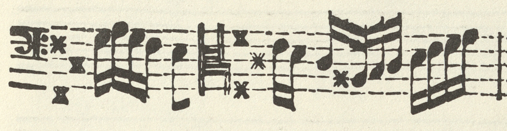
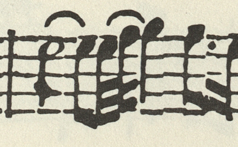

# Supplemental source excerpts

These limited facsimile excerpts document readings discussed in the MEI
annotations. Include this directory and its attribution with the score in the
final release, preserving the relative paths. Crop provenance and checksums are
recorded in [manifest.json](manifest.json).

## Op. II/2, measure 189, viola da gamba

**Source:** Dieterich Buxtehude, *VII. Suonate à due, violino et violadagamba
con cembalo*, Op. II (1696), Uppsala University Library, Düben Collection,
`Uimtr 52:1–4`, RISM A/I B5205. Reproduced through the STIMU facsimile edition
(Utrecht, 1991; introduction by Kerala J. Snyder), supplied as university-library
scans. The digitising institution was not named in the supplied provenance.

**Location:** Viola da gamba part, Sonata II, Parte V, seventh bar, corresponding
to combined-score m. 189; supplied scan `scan-0029.jpg`, left page, eleventh staff
line. The crop shows this one measure with its clef and key context. E3 has a
single eighth-note flag; DdT 1903, printed p. 97, instead gives a quarter note.
The [MEI annotation](../11_buxtehude_sonatas_final/buxtehude_op2_02_sonata_d_major_corr.mei#editorial_y1dubf9q)
explains the retained eighth-note reading.

**Image preparation:** a direct crop at the scan's original pixel scale,
1310 × 340 pixels, saved as PNG. Colour, notation and the photographic appearance
are preserved; no retouching, resizing or reconstructed notation is included.
The crop derives from the supplied full-resolution JPEG access image, rather
than a newly read TIFF master. It excludes the modern introduction and other
unrelated material.

**Intended reuse basis (Germany, recorded 2026-10-19):** documentary image
quotation accompanying the critical discussion of this specific reading under
[UrhG § 51](https://www.gesetze-im-internet.de/urhg/__51.html), with attribution
under [§ 63](https://www.gesetze-im-internet.de/urhg/__63.html). The source image
is needed to show the printed flag and its immediate musical context; the
extent is restricted to that measure. This is a proposed basis for this use,
not a conclusion that small images are automatically exempt from rights or
that every use in every jurisdiction is covered.

The repository's MIT license covers its MEI data, not this source image. No
standalone image license or general permission to redistribute the STIMU books
or supplied scan collection is granted here. Their scan-supply terms remain
unconfirmed; any applicable contractual terms require separate consideration.

## Op. II/6, measure 3, violin

**Source:** Dieterich Buxtehude, *VII. Suonate à due, violino et violadagamba
con cembalo*, Op. II (1696), Uppsala University Library, Düben Collection,
`Uimtr 52:1–4`, RISM A/I B5205. Consulted through the STIMU facsimile edition
(Utrecht, 1991; introduction by Kerala J. Snyder), supplied as university-library
scans. The digitising institution was not named in the supplied provenance.

**Location:** Violino partbook, Sonata VI, printed p. 28, first system, third
measure; supplied `scan-0022.jpg`, left page. The crop shows the complete
measure. On beat 3, the tied E5 has one beam, giving an eighth note; DdT 1903,
printed p. 139, instead gives a sixteenth. The
[MEI annotation](../11_buxtehude_sonatas_final/buxtehude_op2_06_sonata_e_major_corr.mei#ayvjvlf1)
explains the retained eighth-note reading and the rhythmic rationale.

**Image preparation:** a direct crop at the scan's original pixel scale,
485 × 300 pixels, saved as PNG from the supplied full-resolution JPEG access
image. No resizing, retouching or reconstructed notation is included. The
TIFF master was not newly read for this crop. The modern introduction and
unrelated measures are excluded; the part, page and system context are
identified above and in the crop manifest.

**Intended reuse:** this excerpt accompanies the critical discussion of the
specific E5 reading on the same documentary image-quotation basis recorded
above for Op. II/2 (UrhG §§ 51 and 63, checked 2026-10-19). The scope is one
measure, showing the printed beam and its immediate musical context. The same
separation from the MEI-data license and the same qualifications concerning
standalone image reuse and scan-supply terms apply.
