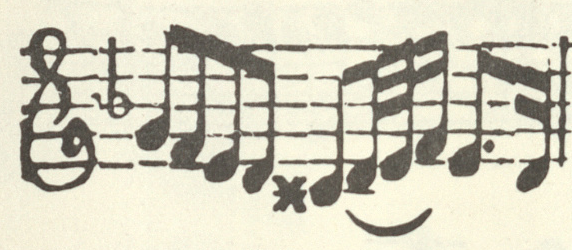
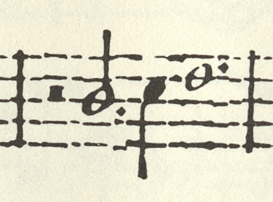
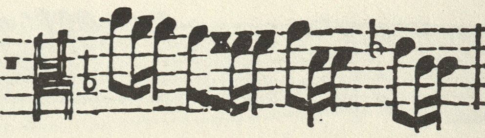
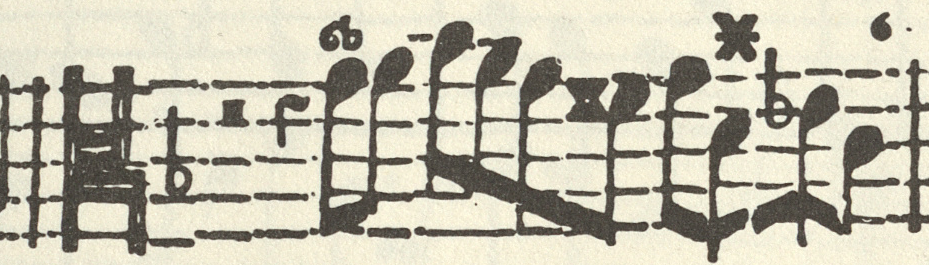

# Supplemental source excerpts

These limited facsimile excerpts document readings discussed in the MEI
annotations. They are listed in the order in which the readings appear in the
volume (DdT 1903, printed pp. 3, 85, 97, 105 and 139). Include this directory and its
attribution with the score in the final release, preserving the relative paths.
Crop provenance and checksums are recorded in [manifest.json](manifest.json).

## Reuse basis

**Intended reuse basis (Germany, recorded 2026-10-19):** documentary image
quotation accompanying the critical discussion of each specific reading under
[UrhG § 51](https://www.gesetze-im-internet.de/urhg/__51.html), with attribution
under [§ 63](https://www.gesetze-im-internet.de/urhg/__63.html). Each source
image is needed to show the printed notation and its immediate musical context;
the extent of each excerpt is restricted to one printed source bar, which
may correspond to more than one measure in DdT. This is a proposed
basis for this use, not a conclusion that small images are automatically exempt
from rights or that every use in every jurisdiction is covered.

The repository's MIT license covers its MEI data, not these source images. No
standalone image license or general permission to redistribute the STIMU books
or supplied scan collection is granted here. Their scan-supply terms remain
unconfirmed; any applicable contractual terms require separate consideration.

## Op. I/1, measure 11, violin

**Source:** Dieterich Buxtehude, *VII. Suonate à doi, Violino & Violadagamba,
con Cembalo*, Op. I (undated; [1696] in the Uppsala catalogue), Uppsala
University Library, Düben Collection, `Uimtr 52:1–4`, RISM A/I B5204. Consulted
through the STIMU facsimile edition (Utrecht, 1991; introduction by Kerala J.
Snyder), supplied as university-library scans. The digitising institution was
not named in the supplied provenance.

**Location:** Violino partbook, Sonata I, opening music page (signature A),
third system, first bar, corresponding to combined-score m. 11; supplied
`scan-0006.jpg`, right-hand page. The crop shows this one measure with its clef
and key context. The C-sharp4 is joined to the following notes by a single
primary beam, giving an eighth note, while the following D and E have
additional beams; DdT 1903, printed p. 3, instead gives a sixteenth. The
[MEI annotation](../11_buxtehude_sonatas_final/buxtehude_op1_01_sonata_f_major_corr.mei#editorial_00dbfb1e88e5)
explains the eighth-note reading.

**Image preparation:** a direct crop at the scan's original pixel scale,
572 × 250 pixels, saved as PNG from the supplied full-resolution JPEG access
image. No resizing, retouching or reconstructed notation is included. The
TIFF master was not newly read for this crop. The facing page and unrelated
measures are excluded; the part, page and system context are identified above
and in the crop manifest.

**Intended reuse:** this excerpt accompanies the critical discussion of the
specific C-sharp4 reading on the documentary image-quotation basis recorded above
(UrhG §§ 51 and 63, checked 2026-10-19). The scope is one measure, showing the
printed beaming and its immediate musical context.

## Op. II/1, measure 114, viola da gamba

**Source:** Dieterich Buxtehude, *VII. Suonate à due, violino et violadagamba
con cembalo*, Op. II (1696), Uppsala University Library, Düben Collection,
`Uimtr 52:1–4`, RISM A/I B5205. Consulted through the STIMU facsimile edition
(Utrecht, 1991; introduction by Kerala J. Snyder), supplied as
university-library scans. The digitising institution was not named in the
supplied provenance.

**Location:** Viola da Gamba part, Sonata I, Grave, printed p. 4, fifth staff
(alto clef, C on the third line); supplied `scan-0027.jpg`, left-hand page,
corresponding to combined-score m. 114. The historical print groups DdT
measures 113–114 into one bar. The crop shows that complete bar between both
barlines: half rest, C4 dotted half, D4 quarter and E4 dotted whole. The E4
has a visible augmentation dot. Its location follows the preceding C4 dotted
half and D4 quarter, and precedes the next D4 whole. DdT 1903, printed p. 85,
omits the dot. The
[MEI annotation](../11_buxtehude_sonatas_final/buxtehude_op2_01_sonata_b_flat_major_corr.mei#editorial.op2.01.m114.e4-dot)
documents the source-supported dotted whole, which fills the six quarter-note
beats of 3/2. This passage was directly compared on 2026-10-25; the comparison
does not constitute complete collation of the work with the historical print.

**Image preparation:** a direct crop at the scan's original pixel scale, 460 ×
340 pixels, saved as PNG from the supplied full-resolution JPEG access image
after verifying its SHA-256 against the conversion inventory. The crop shows
the entire printed bar containing E4, including both barlines and all
preceding notation in that bar; the part, clef context, page and staff are
identified above. No resizing, retouching or reconstructed notation is
included. The TIFF master was not read for this crop. Coordinates, source
checksum and upstream master provenance are recorded in the crop manifest.

**Intended reuse:** this excerpt accompanies the critical discussion of the
specific E4 augmentation dot on the documentary image-quotation basis recorded
above. The scope is one historical-print bar, corresponding to DdT measures
113–114, showing the E4 dot and its complete rhythmic context; no general
scan-redistribution permission is asserted.
## Op. II/2, measure 189, viola da gamba

**Source:** Dieterich Buxtehude, *VII. Suonate à due, violino et violadagamba
con cembalo*, Op. II (1696), Uppsala University Library, Düben Collection,
`Uimtr 52:1–4`, RISM A/I B5205. Reproduced through the STIMU facsimile edition
(Utrecht, 1991; introduction by Kerala J. Snyder), supplied as university-library
scans. The digitising institution was not named in the supplied provenance.

**Location:** Viola da gamba part, Sonata II, Parte V, seventh bar, corresponding
to combined-score m. 189; supplied scan `scan-0029.jpg`, left page, eleventh staff
line. The crop shows this one measure with its clef and key context. E3 has a
single eighth-note flag; DdT 1903, printed p. 97, instead gives a quarter note.
The [MEI annotation](../11_buxtehude_sonatas_final/buxtehude_op2_02_sonata_d_major_corr.mei#editorial_y1dubf9q)
explains the retained eighth-note reading.

**Image preparation:** a direct crop at the scan's original pixel scale,
1310 × 340 pixels, saved as PNG. Colour, notation and the photographic appearance
are preserved; no retouching, resizing or reconstructed notation is included.
The crop derives from the supplied full-resolution JPEG access image, rather
than a newly read TIFF master. It excludes the modern introduction and other
unrelated material.

**Intended reuse:** this excerpt accompanies the critical discussion of the
specific E3 reading on the documentary image-quotation basis recorded above
(UrhG §§ 51 and 63, checked 2026-10-19). The scope is one measure, showing the
printed flag and its immediate musical context.

## Op. II/3, measure 43, viola da gamba and continuo

**Source:** Dieterich Buxtehude, *VII. Suonate à due, violino et violadagamba
con cembalo*, Op. II (1696), Uppsala University Library, Düben Collection,
`Uimtr 52:1–4`, RISM A/I B5205. Reproduced through the STIMU facsimile edition
(Utrecht, 1991; introduction by Kerala J. Snyder), supplied as university-library
scans. The digitising institution was not named in the supplied provenance.

**Location:** Viola da Gamba part, Sonata III, printed p. 12, first staff;
supplied scan `scan-0031.jpg`, left-hand page. The first crop shows the whole-bar
rest of combined-score m. 42, the change to the alto clef (C clef on the third line)
with its B-flat key signature, and m. 43 up to its closing barline. Cembalo
part, Sonata III, printed p. 9, ninth staff; supplied scan `scan-0045.jpg`,
right-hand page. The historical print groups DdT measures 42 and 43 into one
bar; the second crop shows that complete bar between its barlines, opening with
the same clef change, with the figures printed above the bass. In both parts
the m. 43 eighth on the fourth line of the alto clef carries a flat: E-flat4.
DdT 1903, printed p. 105, prints the same clefs at the end of m. 41. The
encoding had lost them and read these notes in bass clef, a seventh too low,
which gave F-flat3 for this E-flat4. The
[MEI annotation](../11_buxtehude_sonatas_final/buxtehude_op2_03_sonata_g_minor_corr.mei#editorial.op2_03.m043.alto-clefs)
records the repair.

**Image preparation:** direct crops at the scans' original pixel scale,
992 × 284 and 929 × 265 pixels, saved as PNG from the supplied full-resolution
JPEG access images, which match their conversion inventory. No resizing,
retouching or reconstructed notation is included. The TIFF masters were not
read for these crops. Each crop excludes the facing page, the neighbouring
staves and the following bar.

**Intended reuse:** these excerpts accompany the critical discussion of the
alto-clef reading on the documentary image-quotation basis recorded above
(UrhG §§ 51 and 63, checked 2026-10-19). The scope is at most one printed bar
per partbook, showing the clef change and the E-flat4 in their immediate
musical context.

## Op. II/6, measure 3, violin

**Source:** Dieterich Buxtehude, *VII. Suonate à due, violino et violadagamba
con cembalo*, Op. II (1696), Uppsala University Library, Düben Collection,
`Uimtr 52:1–4`, RISM A/I B5205. Consulted through the STIMU facsimile edition
(Utrecht, 1991; introduction by Kerala J. Snyder), supplied as university-library
scans. The digitising institution was not named in the supplied provenance.

**Location:** Violino partbook, Sonata VI, printed p. 28, first system, third
measure; supplied `scan-0022.jpg`, left page. The crop shows the complete
measure. On beat 3, the tied E5 has one beam, giving an eighth note; DdT 1903,
printed p. 139, instead gives a sixteenth. The
[MEI annotation](../11_buxtehude_sonatas_final/buxtehude_op2_06_sonata_e_major_corr.mei#ayvjvlf1)
explains the retained eighth-note reading and the rhythmic rationale.

**Image preparation:** a direct crop at the scan's original pixel scale,
525 × 300 pixels, saved as PNG from the supplied full-resolution JPEG access
image. No resizing, retouching or reconstructed notation is included. The
TIFF master was not newly read for this crop. The modern introduction and
unrelated measures are excluded; the part, page and system context are
identified above and in the crop manifest.

**Intended reuse:** this excerpt accompanies the critical discussion of the
specific E5 reading on the documentary image-quotation basis recorded above
(UrhG §§ 51 and 63, checked 2026-10-19). The scope is one measure, showing the
printed beam and its immediate musical context.
