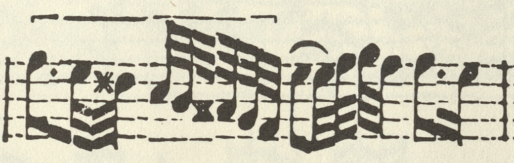
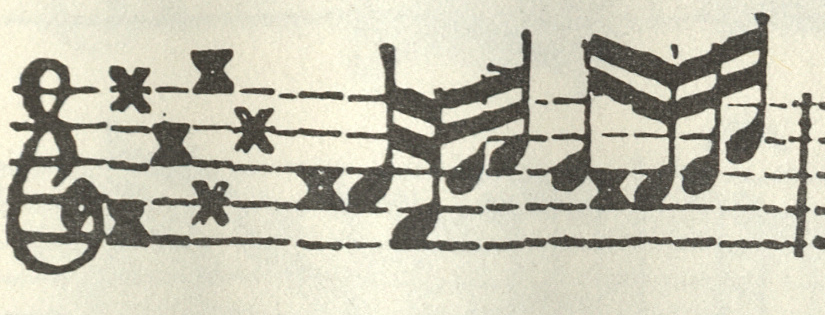
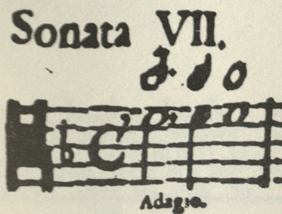
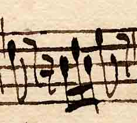
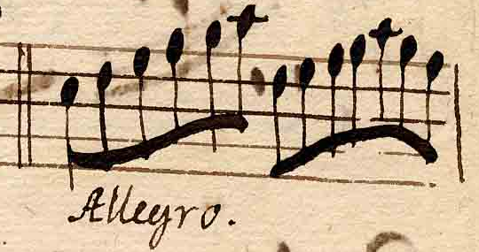
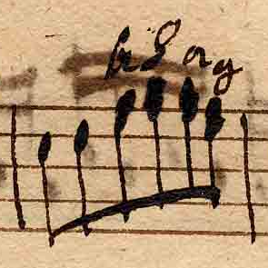

# Supplemental source excerpts

These limited facsimile excerpts document readings discussed in the MEI
annotations. They are listed in the order in which the readings appear in the
volume (DdT 1903, printed pp. 3, 29, 39, 55, 75, 80, 85, 97, 112, 128, 139, 141, 150, 173, 178, 180 and 181). Include this directory and its
attribution with the score in the final release, preserving the relative paths.
Crop provenance and checksums are recorded in [manifest.json](manifest.json).

## Reuse basis

**Intended reuse basis of the fourteen print excerpts (Germany, recorded
2026-10-19):** documentary image
quotation accompanying the critical discussion of each specific reading under
[UrhG § 51](https://www.gesetze-im-internet.de/urhg/__51.html), with attribution
under [§ 63](https://www.gesetze-im-internet.de/urhg/__63.html). Each source
image is needed to show the printed notation and its immediate musical context;
the extent of each excerpt is restricted to one printed source bar, which
may correspond to more than one measure in DdT. This is a proposed
basis for this use, not a conclusion that small images are automatically exempt
from rights or that every use in every jurisdiction is covered.

**The App. II and App. III excerpts (permission of 2026-11-06):** these excerpts come from
manuscript images in Uppsala University Library's Düben database, not from the
STIMU books, and they rest on the library's permission, not on the basis above.
The library wrote on 2026-11-06: “The images published in the Düben database
are freely available for public use without restrictions or fees. You are
therefore free to publish both the whole and parts of the images of these
manuscripts as you like. A reference should include "Uppsala University
Library" and the shelf mark, for example Imhs 13:24.” The credits are therefore
Uppsala University Library, Imhs 13:27 (App. II), and Uppsala University Library,
Imhs 13:24 (App. III). The permission does not extend to the
STIMU prints or the BSB images.

The repository's licenses (CC BY 4.0 for the encodings and documentation, MIT
for the code; see [LICENSE.md](../LICENSE.md)) do not cover these source images. No
standalone image license or general permission to redistribute the STIMU books
or supplied scan collection is granted here. Their scan-supply terms remain
unconfirmed; any applicable contractual terms require separate consideration.

## Op. I/1, measure 11, violin

**Source:** Dieterich Buxtehude, *VII. Suonate à doi, Violino & Violadagamba,
con Cembalo*, Op. I (undated; [1696] in the Uppsala catalogue), Uppsala
University Library, Düben Collection, `Uimtr 52:1–4`, RISM A/I B5204. Consulted
through the STIMU facsimile edition (Utrecht, 1991; introduction by Kerala J.
Snyder), supplied as university-library scans. The digitising institution was
not named in the supplied provenance.

**Location:** Violino partbook, Sonata I, opening music page (signature A),
third system, first bar, corresponding to combined-score m. 11; supplied
`scan-0006.jpg`, right-hand page. The crop shows this one measure with its clef
and key context. The C-sharp4 is joined to the following notes by a single
primary beam, giving an eighth note, while the following D and E have
additional beams; DdT 1903, printed p. 3, instead gives a sixteenth. The
[MEI annotation](../11_buxtehude_sonatas_final/buxtehude_op1_01_sonata_f_major_corr.mei#editorial_00dbfb1e88e5)
explains the eighth-note reading.

**Image preparation:** a direct crop at the scan's original pixel scale,
572 × 250 pixels, saved as PNG from the supplied full-resolution JPEG access
image. No resizing, retouching or reconstructed notation is included. The
TIFF master was not newly read for this crop. The facing page and unrelated
measures are excluded; the part, page and system context are identified above
and in the crop manifest.

**Intended reuse:** this excerpt accompanies the critical discussion of the
specific C-sharp4 reading on the documentary image-quotation basis recorded above
(UrhG §§ 51 and 63, checked 2026-10-19). The scope is one measure, showing the
printed beaming and its immediate musical context.

## Op. I/3, measure 169, viola da gamba

**Source:** Dieterich Buxtehude, *VII. Suonate à doi, Violino & Violadagamba,
con Cembalo*, Op. I (undated; [1696] in the Uppsala catalogue), Uppsala
University Library, Düben Collection, `Uimtr 52:1–4`, RISM A/I B5204. Consulted
through the STIMU facsimile edition (Utrecht, 1991; introduction by Kerala J.
Snyder), supplied as university-library scans. The digitising institution was
not named in the supplied provenance.

**Location:** Violadagamba partbook, Sonata III, Vivace, third staff, first
printed bar, corresponding to combined-score m. 169; supplied `scan-0025.jpg`,
left-hand page. The crop shows the complete bar with the bass clef at the
staff start and no key signature there: B-flat3, A3, B-flat3, C4, B-flat3,
C4, all eighth notes. Each B3 has its own printed flat; the target is the flat
before the opening B3. DdT 1903, printed p. 29, gives that opening B3 without
a sign (B-natural3); its first flat is on the B3 at beat 2. The
[MEI annotation](../11_buxtehude_sonatas_final/buxtehude_op1_03_sonata_a_minor_corr.mei#editorial.clash.op103-m169-b1)
explains the source-supported bracketed editorial flat on the opening B3.
This passage was directly compared on 2026-11-03; the comparison does not
constitute complete collation of the work with the historical print.

**Image preparation:** a direct crop at the scan's original pixel scale,
410 × 250 pixels, saved as PNG from the supplied full-resolution JPEG access
image after verifying its SHA-256 against the conversion inventory. The crop
shows the entire printed bar, including the staff-start bass clef and closing
barline; the part, page and staff are identified above. No resizing,
retouching or reconstructed notation is included. The TIFF master was not
read for this crop. Coordinates, source checksum and upstream master
provenance are recorded in the crop manifest.

**Intended reuse:** this excerpt accompanies the critical discussion of the
specific opening B3 flat on the documentary image-quotation basis recorded
above. The scope is one historical-print bar, corresponding to DdT measure
169, showing the printed flats and their immediate musical context; no
general scan-redistribution permission is asserted.

## Op. I/4, measure 105, violin

**Source:** Dieterich Buxtehude, *VII. Suonate à doi, Violino & Violadagamba,
con Cembalo*, Op. I (undated; [1696] in the Uppsala catalogue), Uppsala
University Library, Düben Collection, `Uimtr 52:1–4`, RISM A/I B5204. Consulted
through the STIMU facsimile edition (Utrecht, 1991; introduction by Kerala J.
Snyder), supplied as university-library scans. The digitising institution was
not named in the supplied provenance.

**Location:** Violino partbook, Sonata IV, sixth staff, first printed bar,
corresponding to combined-score m. 105; supplied `scan-0013.jpg`, right-hand
page. The crop shows the complete bar with the treble clef and key signature
at the staff start: B-flat and E-flat, as in DdT, though the print doubles the
E-flat at the octave. The twelve notes are B-flat4, D5, E5, F5, G5, A-flat5, G5, C5, E5,
D5, C5, B-flat4. A natural stands before the third note and a flat before the
sixth; the target is the ninth note, an E5 with no sign. This print signs each
note separately, so the natural does not reach it and the signature makes it
E-flat5. The attestation is the signature together with an unsigned note,
not a written flat. DdT 1903, printed p. 39, prints the same natural, which
carries in its notation to this E5 (E-natural5). The
[MEI annotation](../11_buxtehude_sonatas_final/buxtehude_op1_04_sonata_b_flat_major_corr.mei#editorial.clash.op104-m105-b3_67)
explains the source-supported bracketed editorial flat on the E5.
This passage was directly compared on 2026-11-05; the comparison does not
constitute complete collation of the work with the historical print.

**Image preparation:** a direct crop at the scan's original pixel scale,
710 × 270 pixels, saved as PNG from the supplied full-resolution JPEG access
image after verifying its SHA-256 against the conversion inventory. The crop
shows the entire printed bar, including the staff-start clef and key signature,
on which the reading rests, and the closing barline at its right edge; the
part, page and staff are identified above. No resizing,
retouching or reconstructed notation is included. The TIFF master was not
read for this crop. Coordinates, source checksum and upstream master
provenance are recorded in the crop manifest.

**Intended reuse:** this excerpt accompanies the critical discussion of the
specific E5 on the documentary image-quotation basis recorded above. The scope
is one historical-print bar, corresponding to DdT measure 105, showing the key
signature, the printed natural and the unsigned note in their immediate musical
context; no general scan-redistribution permission is asserted.

## Op. I/6, measure 13, viola da gamba

**Source:** Dieterich Buxtehude, *VII. Suonate à doi, Violino & Violadagamba,
con Cembalo*, Op. I (undated; [1696] in the Uppsala catalogue), Uppsala
University Library, Düben Collection, `Uimtr 52:1–4`, RISM A/I B5204. Consulted
through the STIMU facsimile edition (Utrecht, 1991; introduction by Kerala J.
Snyder), supplied as university-library scans. The digitising institution was
not named in the supplied provenance.

**Location:** Violadagamba partbook, Sonata VI, Allegro, first staff, third
(last) printed bar, corresponding to combined-score m. 13; supplied
`scan-0029.jpg`, left-hand page. The crop shows D3 eighth,
D4–F4–E4–D4–C4–B-natural3 sixteenths, A3 eighth, and
D4–E4–D4–C4–B-natural3–A3 sixteenths. Both B3s have printed naturals, at
beats 2.75 and 4.5. The tenor C clef (C4 on the fourth line) and B-flat key
signature at the clef change left of the preceding printed bar are outside
the crop. The naturals cancel B-flat; the flourish at the right staff end is
a custos, not a note. DdT 1903, printed p. 55, gives both B3s without signs
(B-flat3 under the one-flat key). The
[MEI annotation](../11_buxtehude_sonatas_final/buxtehude_op1_06_sonata_d_minor_corr.mei#editorial.clash.op106-m13-b2_75)
explains the source-supported bracketed editorial natural and its carry to
the second B3. This passage was directly compared on 2026-11-03; the comparison
does not constitute complete collation of the work with the historical print.

**Image preparation:** a direct crop at the scan's original pixel scale,
720 × 255 pixels, saved as PNG from the supplied full-resolution JPEG access
image after verifying its SHA-256 against the conversion inventory. The crop
shows the entire printed bar containing both B3s; the part, clef and key
context, page and staff are identified above. No resizing, retouching or
reconstructed notation is included. The TIFF master was not read for this
crop. Coordinates, source checksum and upstream master provenance are
recorded in the crop manifest.

**Intended reuse:** this excerpt accompanies the critical discussion of the
specific B3 naturals on the documentary image-quotation basis recorded above.
The scope is one historical-print bar, corresponding to DdT measure 13,
showing both printed naturals and their immediate musical context; no general
scan-redistribution permission is asserted.

## Op. I/7, measures 201–203, viola da gamba

**Source:** Dieterich Buxtehude, *VII. Suonate à doi, Violino & Violadagamba,
con Cembalo*, Op. I (undated; [1696] in the Uppsala catalogue), Uppsala
University Library, Düben Collection, `Uimtr 52:1–4`, RISM A/I B5204. Consulted
through the STIMU facsimile edition (Utrecht, 1991; introduction by Kerala J.
Snyder), supplied as university-library scans. The digitising institution was
not named in the supplied provenance.

**Location:** Violadagamba partbook, Sonata VII, Prestissimo, fourth staff,
third printed bar, which covers combined-score mm. 201–203; supplied
`scan-0032.jpg`, left-hand page. The crop shows a bass clef after the barline
of m. 200, with its sharps on F3 and F2, then the rest of m. 201 with its
figure 1, an eighth rest, D4, D4 (m. 202) and A-sharp3, B3, C-sharp4 (m. 203),
all eighth notes, each sharp a printed ×. DdT 1903, printed p. 75, has no clef
change here: its alto clef stays in force through m. 203, so the same staff
positions read C5, C5 and G-sharp4, A4, B-sharp4. The
[MEI annotation](../11_buxtehude_sonatas_final/buxtehude_op1_07_sonata_e_minor_corr.mei#editorial.clash.op107-m201-clef)
explains the source-supported clef and the five pitches that follow from it.
This passage was directly compared on 2026-11-05; the comparison does not
constitute complete collation of the work with the historical print.

**Image preparation:** a direct crop at the scan's original pixel scale,
555 × 280 pixels, saved as PNG from the supplied full-resolution JPEG access
image after verifying its SHA-256 against the conversion inventory. The crop
shows the entire printed bar between its two barlines; at the left edge it
keeps the dot of the note that ends m. 200, and the notehead at the foot of the
crop belongs to the next staff. The part, page and staff are identified above.
No resizing,
retouching or reconstructed notation is included. The TIFF master was not
read for this crop. Coordinates, source checksum and upstream master
provenance are recorded in the crop manifest.

**Intended reuse:** this excerpt accompanies the critical discussion of the
specific clef on the documentary image-quotation basis recorded above. The
scope is one historical-print bar, corresponding to DdT measures 201–203,
showing the printed clef and the notes it governs; no general
scan-redistribution permission is asserted.

## Op. II/1, measure 24, viola da gamba

**Source:** Dieterich Buxtehude, *VII. Suonate à due, violino et violadagamba
con cembalo*, Op. II (1696), Uppsala University Library, Düben Collection,
`Uimtr 52:1–4`, RISM A/I B5205. Consulted through the STIMU facsimile edition
(Utrecht, 1991; introduction by Kerala J. Snyder), supplied as
university-library scans. The digitising institution was not named in the
supplied provenance.

**Location:** Viola da gamba part, Sonata I, opening Allegro, sixth staff,
fourth printed bar; supplied `scan-0026.jpg`, left-hand page. The print's
barlines fall a dotted quarter later than DdT's here: this printed bar holds
the second half of DdT measure 23 and the first half of measure 24. The crop
shows D4 eighth, D4 sixteenth, E-natural4 sixteenth, F4 eighth, F4 eighth,
E-natural4 sixteenth, F4 sixteenth and G4 eighth. The target E4, at beat 2 of
DdT measure 24, has the second natural in the crop. The alto clef (C4 on the
third line) and two flats at the start of staff 6 are outside the crop.
DdT 1903, printed p. 80, gives the target E4 without a sign (E-flat4 under
the two-flat key). Measure 24's final F4 is in the next printed bar. The
[MEI annotation](../11_buxtehude_sonatas_final/buxtehude_op2_01_sonata_b_flat_major_corr.mei#editorial.clash.op201-m24-b2)
explains the source-supported bracketed editorial natural. This passage was
directly compared on 2026-11-03; the comparison does not constitute complete
collation of the work with the historical print.

**Image preparation:** a direct crop at the scan's original pixel scale,
558 × 320 pixels, saved as PNG from the supplied full-resolution JPEG access
image after verifying its SHA-256 against the conversion inventory. The crop
shows the entire printed bar containing the target E4, including both
barlines and all preceding notation in that bar; the part, clef and key
context, page and staff are identified above. No resizing, retouching or
reconstructed notation is included. The TIFF master was not read for this
crop. Coordinates, source checksum and upstream master provenance are
recorded in the crop manifest.

**Intended reuse:** this excerpt accompanies the critical discussion of the
specific E4 natural at beat 2 of DdT measure 24 on the documentary
image-quotation basis recorded above. The scope is one historical-print bar,
holding the second half of DdT measure 23 and the first half of measure 24,
showing the target natural and its immediate musical context; no general
scan-redistribution permission is asserted.

## Op. II/1, measure 114, viola da gamba

**Source:** Dieterich Buxtehude, *VII. Suonate à due, violino et violadagamba
con cembalo*, Op. II (1696), Uppsala University Library, Düben Collection,
`Uimtr 52:1–4`, RISM A/I B5205. Consulted through the STIMU facsimile edition
(Utrecht, 1991; introduction by Kerala J. Snyder), supplied as
university-library scans. The digitising institution was not named in the
supplied provenance.

**Location:** Viola da Gamba part, Sonata I, Grave, printed p. 4, fifth staff
(alto clef, C on the third line); supplied `scan-0027.jpg`, left-hand page,
corresponding to combined-score m. 114. The historical print groups DdT
measures 113–114 into one bar. The crop shows that complete bar between both
barlines: half rest, C4 dotted half, D4 quarter and E4 dotted whole. The E4
has a visible augmentation dot. Its location follows the preceding C4 dotted
half and D4 quarter, and precedes the next D4 whole. DdT 1903, printed p. 85,
omits the dot. The
[MEI annotation](../11_buxtehude_sonatas_final/buxtehude_op2_01_sonata_b_flat_major_corr.mei#editorial.op2.01.m114.e4-dot)
documents the source-supported dotted whole, which fills the six quarter-note
beats of 3/2. This passage was directly compared on 2026-10-25; the comparison
does not constitute complete collation of the work with the historical print.

**Image preparation:** a direct crop at the scan's original pixel scale, 460 ×
340 pixels, saved as PNG from the supplied full-resolution JPEG access image
after verifying its SHA-256 against the conversion inventory. The crop shows
the entire printed bar containing E4, including both barlines and all
preceding notation in that bar; the part, clef context, page and staff are
identified above. No resizing, retouching or reconstructed notation is
included. The TIFF master was not read for this crop. Coordinates, source
checksum and upstream master provenance are recorded in the crop manifest.

**Intended reuse:** this excerpt accompanies the critical discussion of the
specific E4 augmentation dot on the documentary image-quotation basis recorded
above. The scope is one historical-print bar, corresponding to DdT measures
113–114, showing the E4 dot and its complete rhythmic context; no general
scan-redistribution permission is asserted.
## Op. II/2, measure 189, viola da gamba

**Source:** Dieterich Buxtehude, *VII. Suonate à due, violino et violadagamba
con cembalo*, Op. II (1696), Uppsala University Library, Düben Collection,
`Uimtr 52:1–4`, RISM A/I B5205. Reproduced through the STIMU facsimile edition
(Utrecht, 1991; introduction by Kerala J. Snyder), supplied as university-library
scans. The digitising institution was not named in the supplied provenance.

**Location:** Viola da gamba part, Sonata II, Parte V, seventh bar, corresponding
to combined-score m. 189; supplied scan `scan-0029.jpg`, left page, eleventh staff
line. The crop shows this one measure with its clef and key context. E3 has a
single eighth-note flag; DdT 1903, printed p. 97, instead gives a quarter note.
The [MEI annotation](../11_buxtehude_sonatas_final/buxtehude_op2_02_sonata_d_major_corr.mei#editorial_y1dubf9q)
explains the retained eighth-note reading.

**Image preparation:** a direct crop at the scan's original pixel scale,
1310 × 340 pixels, saved as PNG. Colour, notation and the photographic appearance
are preserved; no retouching, resizing or reconstructed notation is included.
The crop derives from the supplied full-resolution JPEG access image, rather
than a newly read TIFF master. It excludes the modern introduction and other
unrelated material.

**Intended reuse:** this excerpt accompanies the critical discussion of the
specific E3 reading on the documentary image-quotation basis recorded above
(UrhG §§ 51 and 63, checked 2026-10-19). The scope is one measure, showing the
printed flag and its immediate musical context.

## Op. II/3, measure 167, viola da gamba

**Source:** Dieterich Buxtehude, *VII. Suonate à due, violino et violadagamba
con cembalo*, Op. II (1696), Uppsala University Library, Düben Collection,
`Uimtr 52:1–4`, RISM A/I B5205. Consulted through the STIMU facsimile edition
(Utrecht, 1991; introduction by Kerala J. Snyder), supplied as
university-library scans. The digitising institution was not named in the
supplied provenance.

**Location:** Viola da gamba part, Sonata III, printed p. 14, sixth staff, third
printed bar, corresponding to combined-score m. 167; supplied `scan-0032.jpg`,
left-hand page. The crop shows the twelve sixteenths of the bar: C3, A-flat3,
G3, F3, E-flat3, C4, B-flat3, A-flat3, G3, E-flat2, G2, E-flat2. The targets are
the flats before the two low Es, the tenth and twelfth notes. DdT 1903, printed
p. 112, gives both without a sign (E-natural2). The
[MEI annotation](../11_buxtehude_sonatas_final/buxtehude_op2_03_sonata_g_minor_corr.mei#editorial.clash.op203-m167-b3_25)
explains the source-supported bracketed editorial flat on the first E2, which
carries to the second. This passage was directly compared on 2026-11-05; the
comparison does not constitute complete collation of the work with the
historical print.

**Image preparation:** a direct crop at the scan's original pixel scale,
825 × 345 pixels, saved as PNG from the supplied full-resolution JPEG access
image after verifying its SHA-256 against the conversion inventory. The crop
runs from just after the opening barline to the closing barline; the vertical
line near its middle is a stem, not a barline. The clef and key signature stand
at the staff start, outside the crop, and the part, page and staff are
identified above. No resizing,
retouching or reconstructed notation is included. The TIFF master was not
read for this crop. Coordinates, source checksum and upstream master
provenance are recorded in the crop manifest.

**Intended reuse:** this excerpt accompanies the critical discussion of the
two specific low E-flats on the documentary image-quotation basis recorded
above. The scope is one historical-print bar, corresponding to DdT measure 167,
showing the printed flats and their immediate musical context; no general
scan-redistribution permission is asserted.

## Op. II/3, measure 168, viola da gamba

**Source:** Dieterich Buxtehude, *VII. Suonate à due, violino et violadagamba
con cembalo*, Op. II (1696), Uppsala University Library, Düben Collection,
`Uimtr 52:1–4`, RISM A/I B5205. Consulted through the STIMU facsimile edition
(Utrecht, 1991; introduction by Kerala J. Snyder), supplied as
university-library scans. The digitising institution was not named in the
supplied provenance.

**Location:** Viola da gamba part, Sonata III, printed p. 14, seventh staff,
first printed bar; supplied `scan-0032.jpg`, left-hand page. Measure 168 breaks
at the end of staff 6, and this bar holds its continuation: D3, B-flat3, A3, G3,
F-sharp3, D2, F-sharp2, D2, all sixteenths. The target is the sign before the
F2 between the two D2s. It is flooded with ink and has run into the lowest
staff line and the ledger line below it. It is read from its outline, which has
the waist of the print's × (26 pixels against 28 on the × of the F3 in this
bar), and from the gap it stands in: about 85–87 pixels from notehead centre to
notehead centre, against 38–50 for unsigned notes and 90–98 for signed ones in
the same print.
An AI model first read no sign here; the editor decided the reading on
2026-11-05 from enlarged crops. DdT 1903, printed p. 112, gives the F2 without a
sign (F-natural2). The
[MEI annotation](../11_buxtehude_sonatas_final/buxtehude_op2_03_sonata_g_minor_corr.mei#editorial.clash.op203-m168-b3_5)
explains the source-supported bracketed editorial sharp. This passage was
directly compared on 2026-11-05; the comparison does not constitute complete
collation of the work with the historical print.

**Image preparation:** a direct crop at the scan's original pixel scale,
525 × 390 pixels, saved as PNG from the supplied full-resolution JPEG access
image after verifying its SHA-256 against the conversion inventory. The crop
starts at the flat of the key signature, with the clef just outside it, and
ends at the closing barline; the first notes of the measure, on staff 6, are
outside it, because no single rectangle at this scale holds both parts of the
bar without other bars. The noteheads at the top edge belong to the staff
above. The part, page and staff are identified above. No resizing,
retouching or reconstructed notation is included. The TIFF master was not
read for this crop. Coordinates, source checksum and upstream master
provenance are recorded in the crop manifest.

**Intended reuse:** this excerpt accompanies the critical discussion of the
specific F2 on the documentary image-quotation basis recorded above. The scope
is the part of one historical-print bar on this staff, corresponding to part of
DdT measure 168, showing the sign and its immediate musical context; no general
scan-redistribution permission is asserted.

## Op. II/5, measure 40, violin

**Source:** Dieterich Buxtehude, *VII. Suonate à due, violino et violadagamba
con cembalo*, Op. II (1696), Uppsala University Library, Düben Collection,
`Uimtr 52:1–4`, RISM A/I B5205. Consulted through the STIMU facsimile edition
(Utrecht, 1991; introduction by Kerala J. Snyder), supplied as university-library
scans. The digitising institution was not named in the supplied provenance.

**Location:** Violino partbook, Sonata V, printed p. 22, sixth staff, second
bar; supplied `scan-0019.jpg`, left page. The crop shows the complete bar. The
F-sharp5 is a dotted eighth, which completes beat 1 with the E5 and D-sharp5
thirty-seconds, and the five thirty-seconds of beat 2 are 3/32 short. DdT 1903,
printed p. 128, gives the F-sharp5 as a dotted sixteenth. The
[MEI annotation](../11_buxtehude_sonatas_final/buxtehude_op2_05_sonata_a_major_corr.mei#editorial.op205.m40.rhythm)
explains the edition's conjecture, a C-sharp5 eighth, and gives the repair that
DdT's Vorbericht proposes. This passage was directly compared on 2026-11-07;
the comparison does not constitute complete collation of the work with the
historical print.

**Image preparation:** a direct crop at the scan's original pixel scale,
1040 × 330 pixels, saved as PNG from the supplied full-resolution JPEG access
image after verifying its SHA-256 against the conversion inventory. The crop runs from barline to barline. No
resizing, retouching or reconstructed notation is included. The TIFF master was
not read for this crop. Coordinates, source checksum and upstream master
provenance are recorded in the crop manifest.

**Intended reuse:** this excerpt accompanies the critical discussion of the
specific rhythm on the documentary image-quotation basis recorded above (UrhG
§§ 51 and 63, checked 2026-10-19). The scope is one historical-print bar,
showing the beams and dots and their immediate musical context; no general
scan-redistribution permission is asserted.

## Op. II/6, measure 3, violin

**Source:** Dieterich Buxtehude, *VII. Suonate à due, violino et violadagamba
con cembalo*, Op. II (1696), Uppsala University Library, Düben Collection,
`Uimtr 52:1–4`, RISM A/I B5205. Consulted through the STIMU facsimile edition
(Utrecht, 1991; introduction by Kerala J. Snyder), supplied as university-library
scans. The digitising institution was not named in the supplied provenance.

**Location:** Violino partbook, Sonata VI, printed p. 28, first system, third
measure; supplied `scan-0022.jpg`, left page. The crop shows the complete
measure. On beat 3, the tied E5 has one beam, giving an eighth note; DdT 1903,
printed p. 139, instead gives a sixteenth. The
[MEI annotation](../11_buxtehude_sonatas_final/buxtehude_op2_06_sonata_e_major_corr.mei#ayvjvlf1)
explains the retained eighth-note reading and the rhythmic rationale.

**Image preparation:** a direct crop at the scan's original pixel scale,
525 × 300 pixels, saved as PNG from the supplied full-resolution JPEG access
image. No resizing, retouching or reconstructed notation is included. The
TIFF master was not newly read for this crop. The modern introduction and
unrelated measures are excluded; the part, page and system context are
identified above and in the crop manifest.

**Intended reuse:** this excerpt accompanies the critical discussion of the
specific E5 reading on the documentary image-quotation basis recorded above
(UrhG §§ 51 and 63, checked 2026-10-19). The scope is one measure, showing the
printed beam and its immediate musical context.

## Op. II/6, measure 49, violin

**Source:** Dieterich Buxtehude, *VII. Suonate à due, violino et violadagamba
con cembalo*, Op. II (1696), Uppsala University Library, Düben Collection,
`Uimtr 52:1–4`, RISM A/I B5205. Consulted through the STIMU facsimile edition
(Utrecht, 1991; introduction by Kerala J. Snyder), supplied as university-library
scans. The digitising institution was not named in the supplied provenance.

**Location:** Violino partbook, Sonata VI, printed p. 29; supplied
`scan-0022.jpg`, right page. Measure 49 breaks at the end of staff 2, and this
crop holds its second half, at the start of staff 3: A-sharp4, F-sharp4, B4,
C-sharp5, then B4, A-sharp4, B4, D-sharp5, all sixteenths. The target is the
third note, B4, where DdT 1903, printed p. 141, has A-sharp4. DdT's Vorbericht
reports the print's reading under “Original hat”. The
[MEI annotation](../11_buxtehude_sonatas_final/buxtehude_op2_06_sonata_e_major_corr.mei#editorial.op206.m49.vorbericht)
records it, and the encoding keeps DdT's text. This passage was directly
compared on 2026-11-07; the comparison does not constitute complete collation
of the work with the historical print.

**Image preparation:** a direct crop at the scan's original pixel scale,
825 × 315 pixels, saved as PNG from the supplied full-resolution JPEG access
image after verifying its SHA-256 against the conversion inventory. The crop starts at the clef and ends at the barline; the first half of the measure, on staff 2, is outside it. No
resizing, retouching or reconstructed notation is included. The TIFF master was
not read for this crop. Coordinates, source checksum and upstream master
provenance are recorded in the crop manifest.

**Intended reuse:** this excerpt accompanies the critical discussion of the
specific B4 on the documentary image-quotation basis recorded above (UrhG §§ 51
and 63, checked 2026-10-19). The scope is the part of one historical-print bar
on this staff, showing the note and its immediate musical context; no general
scan-redistribution permission is asserted.

## Op. II/7, measures 1–2, viola da gamba

**Source:** Dieterich Buxtehude, *VII. Suonate à due, violino et violadagamba
con cembalo*, Op. II (1696), Uppsala University Library, Düben Collection,
`Uimtr 52:1–4`, RISM A/I B5205. Consulted through the STIMU facsimile edition
(Utrecht, 1991; introduction by Kerala J. Snyder), supplied as university-library
scans. The digitising institution was not named in the supplied provenance.

**Location:** Viola da gamba partbook, Sonata VII, printed p. 29, first staff,
first bar; supplied `scan-0039.jpg`, right page. This bar holds DdT's mm. 1–2:
F4 dotted half, F4 quarter, F4 whole, with no second note on the staff. Three
note signs in the same rhythm stand above the staff, under the heading, without
staff lines or ledger lines, so no pitch can be read from them. DdT 1903,
printed p. 150, prints F4 with A4 in round brackets. The
[MEI annotation](../11_buxtehude_sonatas_final/buxtehude_op2_07_sonata_f_major_corr.mei#editorial.sign.op207-m1)
records the print's reading, and the encoding keeps DdT's text. This passage
was directly compared on 2026-11-07; the comparison does not constitute
complete collation of the work with the historical print.

**Image preparation:** a direct crop at the scan's original pixel scale,
560 × 425 pixels, saved as PNG from the supplied full-resolution JPEG access
image after verifying its SHA-256 against the conversion inventory. The crop holds the heading, the bar from the clef to its barline, and the tempo word below. No
resizing, retouching or reconstructed notation is included. The TIFF master was
not read for this crop. Coordinates, source checksum and upstream master
provenance are recorded in the crop manifest.

**Intended reuse:** this excerpt accompanies the critical discussion of the
reading on the documentary image-quotation basis recorded above (UrhG §§ 51 and
63, checked 2026-10-19). The scope is one historical-print bar, corresponding to
DdT mm. 1–2, with its heading and tempo word; no general scan-redistribution
permission is asserted.

## App. II, measure 156, violin II

**Source:** Dieterich Buxtehude, *Sonata à 3* (BuxWV 266), Violino 2do
part, Uppsala University Library, Imhs 13:27 (Düben Collection; header form
`Instr. mus. i hskr. 13:27`, catalogue form `imhs 013:027`).
[Düben catalogue source 2090](https://www2.musik.uu.se/duben/presentationSource1.php?Select_Dnr=2090),
[Violino 2do facsimile](https://www2.musik.uu.se/duben/browsePart.php?Select_Part=02&Select_Dnr=2090&command=restart).

**Location:** image `imhs013,027_p02_01r.jpg`, eleventh staff, fifth bar,
corresponding to combined-score m. 156. The bar begins after the preceding F5.
It reads D5 eighth, eighth rest, sixteenth rest, B4–D5–B4 sixteenths, E5 eighth,
eighth rest. D5 carries the same flag as E5. The
[MEI annotation](../11_buxtehude_sonatas_final/buxtehude_app_02_sonata_2violins_gamba_cembalo_c_major_corr.mei#ayvjvlf1)
records the source-supported replacement of DdT’s D5 quarter and the withdrawal
of the interim conjecture that omitted the eighth rest. Claude read the manuscript
at full resolution; the editor chose on the review page of 2026-11-06.
This selective examination is not a full collation.

**Image preparation:** a direct crop at unchanged pixel scale, 234 × 210 pixels,
saved as lossless PNG from the full-resolution JPEG served by the Düben database.
The input SHA-256 was checked against the database’s copy on 2026-11-06.
The crop box is `(864, 2890, 1098, 3100)` in that 2836 × 3995 image: the whole bar with both
barlines, the foot of the preceding F5’s stem at the lower left and no adjacent staff.
No resizing, retouching or reconstructed
notation is included. Coordinates, checksums and preparation are in the manifest.

**Credit and reuse:** Uppsala University Library, Imhs 13:27. Published under the
library’s permission of 2026-11-06 for images in the Düben database, recorded
under “Reuse basis” above. The edition’s CC BY 4.0 and MIT licenses do not cover
this image.

## App. III, measure 37, viola da gamba

**Source:** Dieterich Buxtehude, *Sonata à 2* (BuxWV 267), manuscript parts
copied by Andreas Düben, dated 27/9 1692, Uppsala University Library, Imhs 13:24
(Instr. mus. i hskr. 13:24; catalogue form imhs 013:024), Düben Collection.
Consulted through the library's online images:
[Düben Collection Database Catalogue, source 2087](https://www2.musik.uu.se/duben/presentationSource1.php?Select_Dnr=2087).

**Location:** Viol di gamba part, eighth staff, third bar, corresponding to
combined-score m. 37; image `imhs013,024_p01_01r.jpg`. The crop shows a
sixteenth rest; D4, C4 and B3 sixteenths; a B3 dotted eighth; an A-sharp3
sixteenth; and B3, F4, D4 and B3 eighths. The target is the sharp before the A3,
the fifth note. The C clef on the fourth line and the key signature stand at the
staff start, outside the crop. The grey noteheads show through from the other
side of the leaf. DdT 1903, printed p. 178, gives the A3 without a sign
(A-natural3). The
[MEI annotation](../11_buxtehude_sonatas_final/buxtehude_app_03_sonata_gamba_violin_cembalo_d_major_corr.mei#editorial.clash.app03-m37-b1_875)
explains the source-supported bracketed editorial sharp. This passage was
directly compared on 2026-11-05; the comparison does not constitute complete
collation of the work with the manuscript.

**Image preparation:** a direct crop at the image's original pixel scale,
465 × 335 pixels, saved as PNG from the JPEG served by the Düben database, whose
SHA-256 was checked against that URL on 2026-11-06. The crop shows the entire
bar, with the foot of the opening barline at its left edge and the closing
barline near its right edge. No resizing, retouching or reconstructed notation
is included. Coordinates, source URL and checksum are recorded in the crop
manifest.

**Permission:** published with the permission of Uppsala University Library,
quoted under [Reuse basis](#reuse-basis). Credit: Uppsala University Library,
Imhs 13:24.

## App. III, measure 92, viola da gamba

**Source:** Dieterich Buxtehude, *Sonata à 2* (BuxWV 267), manuscript parts
copied by Andreas Düben, dated 27/9 1692, Uppsala University Library, Imhs 13:24
(Instr. mus. i hskr. 13:24; catalogue form `imhs 013:024`), Düben Collection.
[Viol di gamba facsimile](https://www2.musik.uu.se/duben/browsePart.php?Select_Part=01&Select_Dnr=2087&command=restart).

**Location and purpose:** Viol di gamba, fol. 1v, end of the third staff,
image `imhs013,024_p01_01v.jpg`, corresponding to combined-score mm. 91–92.
The crop includes the whole manuscript bar from its opening double bar through
the closing barline, with “Allegro” below. It documents the seven eighths
E4 F-sharp4 G4 A4 B4 A4 G4 after the rising figure of m. 91, against
E4 G4 A4 B4 A4 G4 in DdT 1903, printed p. 180, m. 92, and E F-sharp A B A G
in DdT’s Vorbericht. The
[MEI annotation](../11_buxtehude_sonatas_final/buxtehude_app_03_sonata_gamba_violin_cembalo_d_major_corr.mei#editorial.app03.m92.vorbericht)
keeps DdT’s notes. [DdT’s Vorbericht, p. VII (BSB image 9)](https://api.digitale-sammlungen.de/iiif/image/v2/bsb00023199_00009/full/4134,/0/default.jpg),
quoted in the annotation, is linked only; no BSB image is included.
Claude and Codex read both places independently at full resolution; the editor
counted the seven gamba notes, saw the violon marks and chose to keep DdT.
This selective examination is not a collation.

**Image preparation:** a direct crop at unchanged pixel scale, 540 × 285 pixels,
from the full-resolution JPEG served by the Düben database, saved as lossless PNG.
The input SHA-256 was checked against the database’s copy on 2026-11-06. The box is
`(2040, 745, 2580, 1030)` in the 2730 × 4234 source image. The completed PNG was inspected
to confirm the whole bar and “Allegro” are inside. No resizing, retouching or
reconstructed notation is included. Checksums and provenance are in the manifest.

**Credit and reuse:** Uppsala University Library, Imhs 13:24. Published under
the library’s permission of 2026-11-06 for images in the Düben database, recorded
under [Reuse basis](#reuse-basis). The edition’s CC BY 4.0 and MIT licenses do not
cover this image.

## App. III, measure 130, violone

**Source:** Dieterich Buxtehude, *Sonata à 2* (BuxWV 267), manuscript parts
copied by Andreas Düben, dated 27/9 1692, Uppsala University Library, Imhs 13:24
(Instr. mus. i hskr. 13:24; catalogue form `imhs 013:024`), Düben Collection.
[Violon facsimile](https://www2.musik.uu.se/duben/browsePart.php?Select_Part=02&Select_Dnr=2087&command=restart).

**Location and purpose:** Violon, fol. 1v, second staff, image
`imhs013,024_p02_01v.jpg`, corresponding to combined-score m. 130.
The crop includes the whole bar, both barlines and all four marks over the last
four notes. It documents those heavier, less regular heads and the marks, against
E3 G3 A3 B3 A3 G3 in DdT 1903, printed p. 181, m. 130. The last two marks read
a and g; the first two are not securely legible, the first perhaps h. The reading
of the last four notes and what the marks record remain open. The
[MEI annotation](../11_buxtehude_sonatas_final/buxtehude_app_03_sonata_gamba_violin_cembalo_d_major_corr.mei#editorial.app03.m130.vorbericht)
keeps DdT’s notes. The Vorbericht is quoted and linked in the annotation at m. 92.
Claude and Codex read both places independently at full resolution; the editor
counted the seven gamba notes, saw the violon marks and chose to keep DdT.
This selective examination is not a collation.

**Image preparation:** a direct crop at unchanged pixel scale, 295 × 295 pixels,
from the full-resolution JPEG served by the Düben database, saved as lossless PNG.
The input SHA-256 was checked against the database’s copy on 2026-11-06. The box is
`(1150, 530, 1445, 825)` in the 2730 × 4234 source image. The completed PNG was inspected
to confirm both barlines and all four marks are inside. No resizing, retouching or
reconstructed notation is included. Checksums and provenance are in the manifest.

**Credit and reuse:** Uppsala University Library, Imhs 13:24. Published under
the library’s permission of 2026-11-06 for images in the Düben database, recorded
under [Reuse basis](#reuse-basis). The edition’s CC BY 4.0 and MIT licenses do not
cover this image.
